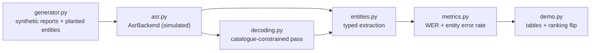

# fieldvoice

> Offline speech-to-structured field reports evaluated on entity error rate, not word error rate - because only the part numbers matter.

[](https://github.com/SlateGitOrg/fieldvoice/actions/workflows/ci.yml)

## Why

A technician at the top of a turbine cannot type a report. They speak it, and later somebody transcribes it into a form. Generic transcription gets the narrative roughly right and mangles exactly the parts that matter (part numbers, torque values, fault codes), which are the only fields the maintenance system consumes. A model with 12% global WER but 0.8% part-number error is far more useful here than one at 6% WER that fluffs every identifier, and only an entity-level metric shows that.

> **Scope.** This repository has no ASR runtime, no audio, no model weights and no network access. Hypotheses come from a deterministic, seeded **simulated ASR backend** behind the `AsrBackend` interface, which corrupts a reference transcript using phonetic confusion classes, number and unit mangling, and spell-out of domain identifiers. What is real is the evaluation (Levenshtein WER, typed entity extraction, entity error rate) and a catalogue-constrained decoding pass that works on recogniser text. A real recogniser (for example whisper.cpp, with the catalogue as a grammar or logit mask) would slot in behind `AsrBackend`.

## Features

- Word error rate by Levenshtein alignment, with every word error classified as on a scored field or on narrative.
- Typed entity extraction: part IDs, fault codes, quantities with units, dates and locations.
- Entity error rate overall and per entity type, so averages cannot hide a weak class.
- Catalogue-constrained decoding that snaps, re-composes spelled-out digits, or routes to a human, and never emits an unvalidated identifier.
- A seeded generator of synthetic field reports with planted ground-truth entities, and a seeded simulated recogniser with general and domain noise profiles.
- Pure Python standard library; the test suite also asserts the pipeline runs with networking disabled.

## Architecture



The generator produces reports with known entities. The backend turns each reference transcript into a noisy hypothesis. Entities are extracted from the hypothesis (optionally after constrained decoding) and compared with the planted ones. `metrics.py` reports WER and entity error rate side by side. See [docs/ARCHITECTURE.md](docs/ARCHITECTURE.md) for design decisions and failure modes.

## Quick start

Requires Python 3.11+. There is nothing to install.

```bash
git clone https://github.com/SlateGitOrg/fieldvoice
cd fieldvoice
python -m unittest discover -s tests   # 80 tests, about a second
python -m src.demo                     # the ranking flip, then corpus tables
```

## Usage

`python -m src.demo` prints three sections. The first is a single utterance with two hypotheses:

```
metric                        A         B     prefers
------------------------------------------------------------
word error rate           0.192     0.231           A
entity error rate         0.833     0.000           B
```

System A gets fewer words wrong, but every error is on a field (`GB-4471` to `GB-4771`, `47 nm` to `47 mm`, ...). System B gets more words wrong, none of them on a field. WER prefers A; the maintenance system needs B.

## How it works

- **Entity error rate.** Gold entities and predicted entities are aligned per type, in order. Unit-only slips (`nm` to `mm`) count as errors even though the magnitude is right.
- **Simulated ASR.** `SimulatedAsr` takes a `NoiseProfile` (noise, accent, domain vocabulary) and corrupts consonants and digits, mangles units and dates, and spells identifiers out as words when they are out of vocabulary.
- **Constrained decoding.** `constrained_decode` first tries to re-compose spelled-out identifiers, then accepts a catalogue match only when it is unique within edit distance 1. Anything else is routed to a human. `naive_nearest_decode` is the baseline that always snaps.

## Results

All numbers below are printed by `python -m src.demo`.

### The headline: the ranking flips

One utterance, two hypotheses. System A gets **fewer words wrong**; every one
of them is a field. System B gets **more words wrong**; not one of them is a
field.

```
REFERENCE  technician inspected gearbox GB-4471 at north ridge on 2024-03-12
           torque was 47 nm and we applied 250 ml of grease before the fault
           code E-212 cleared
SYSTEM A   ... GB-4771 ... 2024-03-21 ... 47 mm ... 250 mg ... E-272 ...
SYSTEM B   technician expected ... torque is 47 nm an he applied 250 ml off
           grease before a fault code E-212 cleared
```

| metric | system A | system B | prefers |
|---|---|---|---|
| word error rate | 0.192 | 0.231 | **A** |
| entity error rate | 0.833 | 0.000 | **B** |

A: 5 word errors, 5 of them on scored fields, 0 on narrative.
B: 6 word errors, 0 of them on scored fields, 6 on narrative.

A loses the part number, the date, both quantities and the fault code. Two of
those five are **unit-only** slips (`nm`->`mm`, `ml`->`mg`): the magnitude is
right, so a number-only check calls them correct. B is word-for-word worse and
files a perfect maintenance record.

### Corpus: 200 generated field reports, two ASR profiles

| metric | A-general | B-domain |
|---|---|---|
| word error rate | 0.201 | 0.213 |
| entity error rate | 0.504 | 0.042 |

Per-entity-type error rate, which the average above hides:

| entity type | A-general | B-domain |
|---|---|---|
| PART_ID | 0.560 | 0.040 |
| FAULT_CODE | 0.560 | 0.030 |
| QUANTITY | 0.585 | 0.048 |
| DATE | 0.440 | 0.045 |
| LOCATION | 0.295 | 0.040 |

Ranked by WER: `A-general < B-domain`. Ranked by entity error rate:
`B-domain < A-general`. The flip survives at corpus scale, not only in the
hand-built sentence.

### Constrained decoding on the general recogniser's own output

Same 200 reports, `A-general` hypotheses, catalogue of 590 parts / 178 fault
codes, with 10 reports carrying a planted part number **not** in the
catalogue. "wrong" = an incorrect ID written into the record.

| type | decoder | wrong | wrong rate | routed to human | missing | unvalidated |
|---|---|---|---|---|---|---|
| PART_ID | none | 63 | 0.315 | 0 | 53 | 63 |
| PART_ID | naive nearest-snap | 22 | 0.110 | 0 | 0 | 0 |
| PART_ID | constrained | 3 | 0.015 | 27 | 0 | 0 |
| FAULT_CODE | none | 65 | 0.325 | 0 | 47 | 55 |
| FAULT_CODE | naive nearest-snap | 48 | 0.240 | 0 | 2 | 0 |
| FAULT_CODE | constrained | 10 | 0.050 | 54 | 2 | 0 |

Spell-outs (`gb forty four seventy one`) that the unconstrained system loses
entirely (53 "missing") are re-composed. The naive snap also emits zero
unvalidated codes - it passes the validation check - yet writes 7x more wrong
parts, because it turns every unknown part into a confident known one.

Suite: **80 tests**, `python -m unittest discover -s tests`, about a second.
All numbers are measured on the simulated backend, not a real model.

## Limitations

- **The recogniser is simulated.** Absolute error rates here are properties of
  the corruption model, not of any real acoustic model. Only the *relationship*
  between the two metrics is a claim about the world, and it follows from the
  arithmetic of the metrics rather than from the simulator.
- **The corpus-level flip is conditional and it is tested as such.** It needs
  the domain-constrained system to be noisy enough on narrative; the measured
  crossover is around a 0.28 narrative error rate. Below it, `B-domain` wins on
  *both* metrics - operationally better, rhetorically weaker.
  `test_flip_needs_narrative_noise` asserts exactly that, so the claim cannot
  quietly become a universal one. The headline single-utterance flip is
  unconditional, being hand-constructed.
- **The entity error rate is invariant to narrative noise, not to everything.**
  Measured spread across narrative rates 0.05 to 0.45 is under 0.02.
- **Entity extraction is rule-based** over a closed gazetteer and fixed ID
  shapes.
- **"Never emits an unvalidated part number" holds; "unknown codes always
  route" does not.** Measured: 9 of 10 planted unknown parts route. The tenth
  (GB-5161 heard as GB-5151, one slip from catalogued GB-5251) is snapped to a
  wrong but valid part. No snapping scheme can see that; only acoustic
  confidence could, and the simulator does not model per-token confidence.
  Gating here is catalogue evidence (unique radius-1 candidate), not acoustic.
- **Constrained decoding degrades as the vocabulary fills the ID space.** On a
  1000-report corpus the fault catalogue covers most of the 900 possible
  `E-ddd` codes and the constrained FAULT_CODE wrong rate rose to 0.183,
  against 0.050 on the 200-report corpus. `test_denser_catalogue_degrades_part_class`
  is the regression that catches a vocabulary change doing this.
- **Radius 2 is not worse on accuracy, only on workload:** it commits no more
  wrong parts than radius 1 but routes more than twice as many to a human
  (`test_radius_two_routes_more`), so radius 1 is the default.
- **Same-type entities are aligned by order.** Two quantities spoken in the
  wrong order score as two substitutions. That is the right call for a report
  where field order carries meaning, and the wrong one for free-form dictation.
- **Two kinds of "domain" system.** `B-domain` in the corpus table is a noise
  profile; the constrained-decoding table is a real post-pass over
  `A-general` text. Neither is a beam search. Only identifiers are
  constrained; quantities, dates and locations are not.
- **Offline** is asserted by a test that patches out `socket` connect /
  resolve and runs the pipeline, plus a scan for network imports in `src/`.
- **Scope.** There is no real ASR, persistence or structuring step; the repository covers the interface and the evaluation.

## Testing

```bash
python -m unittest discover -s tests -v
```

The 80 tests cover the WER and entity error implementations, entity extraction, the simulated backend, the generator, constrained decoding, the single-utterance and corpus-level ranking flips (including the condition under which the corpus-level flip disappears), per-class error thresholds, and a run with `socket` connect and resolve patched out plus a scan of `src/` for network imports.

## Project layout

```
src/entities.py    typed field extraction (IDs, quantities + units, dates, places)
src/metrics.py     WER by Levenshtein DP + entity error rate, per type
src/asr.py         AsrBackend interface + deterministic simulated recogniser
src/generator.py   synthetic field reports with planted ground-truth entities
src/decoding.py    catalogue-constrained decoding: snap / re-compose / route
src/demo.py        runnable demo that prints the tables above
tests/             unit and property-style tests
docs/              architecture notes
```

## Non-goals

- Not a general transcription service; the constraint is the point.
- Not cloud-dependent; the offline requirement drives the design.
- Not an app: no UI, storage or sync layer.

## License

MIT — see [LICENSE](LICENSE).
