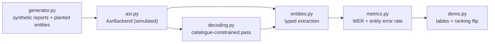

# Architecture

## Context

Wind-turbine maintenance crews dictate reports from the top of a turbine, with
no connectivity. Downstream, the maintenance system consumes only a handful of
typed fields: part numbers, fault codes, quantities with units, dates and
locations. Generic transcription is judged on word error rate (WER), which
treats every word as equally important and so says almost nothing about whether
those fields survived. fieldvoice evaluates, and post-processes, speech output
at the level of those fields.

## Container view

Everything is plain Python standard library. `AsrBackend` is the only seam to
an acoustic model: a real recogniser can replace `SimulatedAsr` without
touching `metrics.py` or `entities.py`.

## Key decisions

**Entity error rate as the headline metric.** WER and entity error rate can
rank two systems in opposite orders. A system with fewer wrong words can still
lose every field (unit-only slips such as `nm` to `mm` are scored as errors);
another with more wrong words can lose none. The suite includes a hand-built
single-utterance flip and a corpus-level flip, and a test showing the
corpus-level flip is conditional on narrative noise.

**Constrained decoding that can refuse.** Identifiers are snapped to a catalogue
only when there is a unique candidate within edit distance 1; spelled-out
digits (`gb forty four seventy one`) are re-composed first. Anything else is
routed to a human instead of being guessed into a record. The alternative, a
naive nearest-neighbour snap, validates every identifier but turns unknown
parts into confident wrong ones, which is why it is kept as a baseline.

**Radius 1 by default.** Radius 2 commits no more wrong parts but routes more
than twice as many to a human.

**Same-type entities are aligned by order.** Field order carries meaning in a
report, so two swapped quantities count as two substitutions.

## Failure modes

- An off-catalogue part one slip from a catalogued part is snapped to the wrong
  but valid part. Only acoustic confidence could catch this, and the simulator
  does not model it.
- A denser catalogue degrades constrained decoding: as the fault-code catalogue
  fills the `E-ddd` space, wrong snaps rise. A regression test covers it.
- Rule-based extraction misses entities outside the closed gazetteer and fixed
  ID shapes.

## Out of scope

Real speech recognition, audio, model weights, structuring with a local LLM,
persistence and deferred sync.
